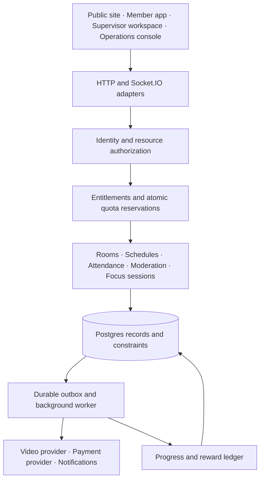

# Halastudy target platform structure

Proposed architecture · 20 October 2026

Keep one deployable application, organized into modules with clear ownership of data and rules. The website should expose separate member, supervisor, organization, and platform-operations experiences, all using the same underlying identity and authorization system.

**One person can be a member, a paying subscriber, a host of one room, and a supervisor of one cohort.** These are separate relationships. Payment never creates administrative authority; earning a badge never changes access-control privileges.

## Four independent systems

| System | Question answered | Example |
|---|---|---|
| Identity | Who is acting, and is their session valid? | Named user with password or Google identity |
| Authorization | May they perform this action on this resource? | Supervisor assigned to cohort A may read cohort A attendance |
| Entitlements | Which product benefits and quantities are available? | Organization has 20 purchased seats and scheduled-room access |
| Progress | What eligible activity has the person completed? | One validated session earns one nonduplicate reward |

For an action involving a paid feature, allow it only when the session/account, resource relationship, feature access, quota reservation, and operational safety checks all succeed. Unknown permissions and features fail closed. Free features have explicit base entitlements rather than relying on missing data.



The outbox stores pending external work in the same transaction as the domain change. Workers retry safely with idempotency keys. These workers can initially run in the same deployment; separate services are unnecessary until operating evidence justifies them.

## Website and navigation

Retain current URLs during migration. New paths below are proposed information architecture, not implemented routes.

| Surface | Suggested routes | Main jobs |
|---|---|---|
| Public | `/`, `/how-it-works`, `/plans`, `/blog`, `/help`, `/privacy`, `/terms` | Understand the product, compare released packages, get help |
| Guest | Existing `/open`, `/lobby`, `/study` | Join quickly, understand room rules, optionally create an account |
| Member | `/app`, `/app/rooms`, `/app/schedule`, `/app/progress`, `/app/settings` | Start studying, manage rooms, review activity, manage account |
| Billing | `/app/billing` | See plan, renewal, invoices, usage, cancellation and payment state |
| Room | Existing `/study` plus a future canonical `/rooms/:code` | Join, focus, use collaborative tools, report a problem |
| Supervisor | `/supervisor`, `/supervisor/cohorts/:id`, `/supervisor/sessions/:id` | Assigned cohorts, attendance, session preparation, escalations |
| Organization | `/org/:id/members`, `/org/:id/rooms`, `/org/:id/billing` | Invite members, assign seats and supervisors, manage organization |
| Platform operations | `/ops/cases`, `/ops/users`, `/ops/catalog`, `/ops/access`, `/ops/audit`, `/ops/health` | Role-appropriate operations and investigation |

Use one account menu with a workspace switcher for people who have multiple roles. The default experience stays focused on studying. Show only permitted navigation, while enforcing all permissions again on the server.

Preserve Arabic-first copy, RTL logical properties, responsive layouts, keyboard navigation, accessible errors and focus states. Package, payment, suspended-account, and empty-cohort screens need complete Arabic and English states. A new route or hidden link is not an authorization boundary.

## People and scopes

| Role | Scope | Permitted purpose | Excluded authority |
|---|---|---|---|
| Guest | Joined room and signed anonymous session | Join permitted rooms, study, participate and report | Durable ownership, staff tools, trusted rewards |
| Member | Own account and joined resources | Personal progress, account management, allowed room creation | Other users' private records |
| Room host | Explicit room assignment | Room settings, cohosts, local moderation | Global bans, organization billing |
| Supervisor | Assigned cohorts or rooms | Run sessions, see appropriate attendance, escalate cases | Unassigned cohorts, payment records, secret camera access |
| Organization admin | One organization | Membership, local assignments, room policy, seat allocation | Platform configuration or another organization |
| Organization billing manager | One billing account | Invoices, subscription and seat purchases | Student attendance and moderation cases |
| Platform moderator | Assigned case/queue and approved operational scope | Investigate reports, apply allowed sanctions | Catalog changes, staff grants, financial exports |
| Platform support | Assigned support case | Minimal account/service information, approved recovery workflow | Passwords, unrestricted impersonation, arbitrary role grants |
| Platform billing operator | Approved billing scope | Reconcile payments, controlled refunds and entitlement corrections | Room content, staff access changes |
| Platform admin | Defined platform operations | Configuration and delegated operational tasks | Granting super-admin privileges |
| Super admin | Explicit platform assignment | Manage privileged grants, policy and emergency recovery | Routine invisible access to private rooms |

Roles compose through explicit assignments; they are not a numeric rank. A platform admin does not automatically inherit every financial or private-content permission.

Implement role assignments with principal, role, scope, grantor, grant time, expiry, and revocation. Scope must reference a valid platform, organization, cohort, room, or case; enforce scope consistency in schema and service code. A room host cannot grant organization roles. An organization admin cannot grant platform roles.

MFA is mandatory for staff. Reauthentication is required for high-impact changes. Privileged grants, bulk exports, refunds above a defined threshold, and emergency access need reason codes and audit events. Protect the last active super admin from accidental removal and keep a tested recovery process. Support impersonation, if ever added, must be explicit, temporary, visible, and audited.

### Representative permission decisions

| Permission | Allowed relationship | Additional condition |
|---|---|---|
| `room.create` | Active member; guest under existing guest policy | Feature enabled and resource quota available |
| `room.manage` | Owner or assigned host | Room active; organization policy permits change |
| `room.join` | Public eligibility or valid private membership/invite | Password where applicable, no sanction, capacity available |
| `room.kick` | Assigned host or authorized moderator | Room/case scope; reason and audit |
| `attendance.read` | Student self or assigned supervisor | Same cohort; minimum necessary fields |
| `org.members.manage` | Organization admin | Same organization; cannot elevate beyond delegated roles |
| `billing.manage` | Personal billing owner or organization billing manager | Recent authentication for sensitive changes |
| `case.resolve` | Assigned moderator or authorized escalation handler | Recorded disposition and reason |
| `platform.roles.grant` | Authorized super admin | MFA, recent authentication, no invalid escalation |
| `progress.adjust` | Narrow operational correction permission | Append compensating ledger entry; never edit totals silently |

A supervisor sees attendance and declared goals, not a supposed mental-focus score. Supervisory access does not grant invisible viewing, recording, or unrestricted personal history. Any future observer experience must be explicit to participants and have its own policy.

## Future packages

The following are candidate offers, not current features, published commitments, or prices.

| Candidate | Audience | Possible benefits | Prerequisites |
|---|---|---|---|
| Free | Individual students | Core study room, timer, basic personal progress | Stable base entitlements |
| Plus | Regular individual users | More reusable rooms, richer personal history, cosmetics | Catalog, quotas, validated activity where relevant |
| Study Circle | Small groups | Shared rooms, group goals, host tools | Durable membership and group billing |
| Supervised Cohort | Tutors and organized groups | Scheduled supervised sessions, per-member attendance | Supervisor assignment, staffing/booking and privacy model |
| Institution | Schools or organizations | Seat allocation, organization administration, scoped reporting | Tenant isolation, billing ownership, support operations |

Do not reclassify currently free features as paid during this refactor. Any future change needs an explicit product decision and communication. Avoid “unlimited” video until cost and capacity support it. Never sell staff authority or leaderboard rank.

Use stable internal feature keys such as `rooms.scheduled`, `rooms.max_owned`, `rooms.max_participants`, `history.retention_days`, `cohorts.enabled`, `reports.export`, and `seats.purchased`. Define unit, aggregation rule, scope, reset period, and enforcement point for every quota.

Version plans and prices separately. Store provider price IDs, currency, billing interval, effective dates, and immutable subscription snapshots. Keep provider-specific fields in the billing adapter. Select a payment provider separately after verifying merchant eligibility and required local payment methods; the architecture does not assume Stripe availability.

### Entitlement resolution

Resolve the explicit free baseline, the active personal subscription, or the selected organization's assigned-seat benefits in the current resource context. Add explicit grants only under their documented combination rule. Never pool every organization a person belongs to, and never blindly sum duplicate benefits.

Each entitlement records its source, beneficiary or organization, scope, value/unit, effective interval, and reason. Manual grants expire and are audited. Feature flags control rollout; entitlements control product access. Keeping both prevents an experiment flag from becoming a payment authorization mechanism.

Reserve quota atomically before external work. For video, enforce the minimum of the applicable room/package allowance and operational cap, plus the independent global capacity reservation. Use expiring reservations with reconciliation after crashes. Release capacity on failure and disconnect.

### Billing lifecycle

Model `pending`, `trialing`, `active`, `past_due`, `suspended`, `canceled`, and `expired` with explicit access rules. A cancel-at-period-end marker keeps access until the paid interval ends. A refund or chargeback follows a documented entitlement policy; it is not equivalent to a harmless duplicate notification.

Only verified provider events or reconciled provider state activate paid access. Verify webhook signatures over the raw body, persist a unique provider/event receipt, process idempotently, and reconcile uncertain ordering against current provider state. Redirects from checkout are user experience signals, not payment evidence. These controls address documented webhook duplicates and unordered delivery. [Webhook reference](https://docs.stripe.com/webhooks)

Show renewal, cancellation, failed payment, and quota exhaustion clearly. Downgrade by preventing new over-limit resources and allowing an explicit migration/grace path; do not silently delete rooms or study history.

## Data model

Use Postgres as the durable system of record. Keep media off the application server. Add Redis or another shared ephemeral store only when multi-process presence, rate limits, and atomic capacity require it.

| Domain | Main records | Required invariants |
|---|---|---|
| Identity | `users`, `identities`, `sessions`, `reauth_challenges` | Unique provider/subject; revocable sessions; no privilege in profile-edit payload |
| Access | `roles`, `permissions`, `role_permissions`, scoped `role_assignments` | Valid scope, no duplicate active grant, audited change |
| Organizations | `organizations`, `memberships`, `invitations` | One membership per user/org; invitations hashed, expiring and single use |
| Rooms | `rooms`, `room_memberships`, `room_invites`, `board_items` | Stable owner, valid organization, explicit participant/host role |
| Scheduling | `cohorts`, `cohort_memberships`, `supervisor_assignments`, `scheduled_sessions`, `session_occurrences`, `attendance` | Unique occurrence/user attendance; assignment required to read cohort |
| Products | `plans`, `plan_versions`, `features`, `plan_features`, `prices` | Stable keys, typed limits, immutable published versions |
| Billing | `billing_accounts`, `subscriptions`, `subscription_items`, `seat_assignments`, `provider_events` | User XOR organization ownership, unique provider IDs/events, atomic seat allocation |
| Access benefits | `entitlement_grants`, `usage_ledger`, `quota_reservations` | Source and expiry, deduplication, atomic reservation/release |
| Focus | `focus_sessions`, `focus_intervals`, `daily_activity` | Unique completion; nonoverlapping counted time per user; UTC timestamps |
| Progress | `xp_ledger`, `achievement_definitions`, `user_achievements`, later `challenges` | Unique source/rule award; compensating reversals |
| Moderation | `reports`, `cases`, `case_assignments`, `moderation_actions`, `sanctions` | Durable independent case ID, actor, reason and disposition |
| Operations | `audit_events`, `outbox_events`, `job_runs`, `deletion_requests` | Durable state, retry/idempotency, restricted audit modification |

Organization-owned child rows carry `organization_id`; use composite foreign keys or equivalent constraints to prevent a room, cohort, or membership from being attached across organizations. Add indexes for scoped lists and unique natural keys. Migrations need both clean-install and upgrade tests.

Use UTC instants for events and a stored IANA timezone for schedules/day grouping, defaulting to `Asia/Riyadh`. Document day-boundary behavior and prevent timezone changes from generating extra rewards.

Keep operational audit records distinct from product analytics. Store actor, action, resource, scope, outcome, request ID, timestamp and reason. Avoid logging credentials, full payment details, or unnecessary room content. Set retention per data class, and ensure deletion/restore procedures cannot casually resurrect removed accounts.

## Gamification built around credible activity

Start with private progress, consistency milestones, and optional cosmetics. Add opt-in cohort challenges later. Defer global leaderboards and redeemable rewards until abuse controls and validation are mature.

1. The server creates an eligible focus session and records its start.
2. Heartbeats and pause/resume transitions define bounded elapsed intervals. A configured disconnect grace period handles normal interruptions.
3. Completion is processed once using a stable session ID. Cap counted intervals by server elapsed time, exclude pauses, and prevent concurrent sessions from doubling one user's time.
4. Commit session completion, daily aggregate changes, and a reward event atomically.
5. A worker awards XP/achievements once per source event and rule version. Duplicate delivery has no effect.

Imported history remains visible as personal history but does not grant competitive rewards. Camera detection is neither required nor accepted as proof of learning. Camera-off users can earn progress through the same eligible session process.

Specify the XP formula, daily ceiling, qualifying-session minimum, grace policy, and rule version before launch. An illustrative first rule is one XP per eligible minute up to a configured daily ceiling; exact values require product choice and observed use. Recompute displayed totals from the ledger and use compensating entries for corrections.

Keep lifetime progress separate from a rolling daily window. Show streaks with humane recovery rules, reminders under user control, and no bought ranking advantage. Rank only consenting users within the selected cohort/period and provide a visibility opt-out.

## Module and repository structure

```text
services/
  identity/          # Accounts, providers, sessions, reauthentication
  authorization/     # Permission catalog, scopes, policy evaluation
  organizations/     # Membership, invitations, seats
  rooms/             # Ownership, membership, board, lifecycle
  scheduling/        # Recurrence, occurrences, attendance
  entitlements/      # Feature grants, resolution, quotas
  billing/           # Catalog and subscription lifecycle
    providers/       # Payment-provider adapters
  progress/          # Focus sessions and activity
  gamification/      # Reward rules and ledgers
  moderation/        # Cases, assignments, sanctions
  audit/             # Durable administrative events
  jobs/              # Outbox dispatch and retry
  video/             # Preserve and extend existing provider boundary
  ops/               # Health, backups, metrics
transport/
  http/              # Input validation and response mapping
  socket/            # Same policies and domain services
repositories/
  postgres/          # Per-record queries and transactions
  file/              # Explicit development compatibility only
db/
  migrations/
  seeds/             # Nonsecret permission/catalog definitions
public/
  js/features/       # Extract page behavior incrementally
  css/
tests/
  unit/
  integration/
  permissions/
  contracts/
  smoke/
```

Do not move everything at once. First extract policy and repository interfaces behind existing routes, then migrate one vertical feature at a time. Transport code validates input and calls domain services; domain services own the transaction and authorization requirements. Provider adapters do not decide product policy.

Continue CommonJS initially. Introduce stricter TypeScript/JSDoc boundaries for new contracts where it adds value; converting the whole frontend is not a prerequisite. Keep the existing design system and shared UI core while extracting inline page behavior.

## Deployment and readiness

Keep one application process through the persistence transition. Durable jobs must have retry limits, dead-letter handling, and visible failures. Before adding workers or replicas, validate shared presence, session revocation, rate limits, quota reservations, reconnect behavior and provider cleanup under concurrency.

Back up the database and room state coherently, rehearse restore, and reconcile outbox jobs, deleted identities, subscriptions and provider sessions afterward. Measure join latency, failed admissions, database commit errors, webhook delay, reward duplication, and media participant-minutes. Define operational targets from real beta traffic.

The first deliverable should be reliable identity, ownership, and authorization. Packages and gamification then become bounded modules rather than scattered checks across pages.
